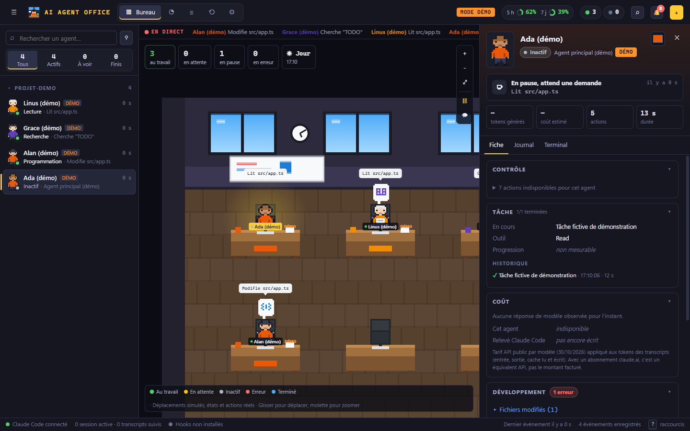
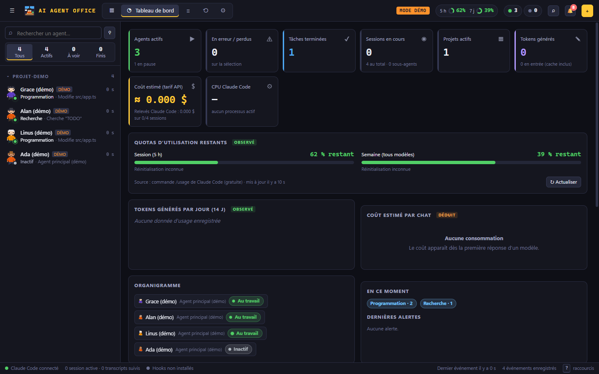
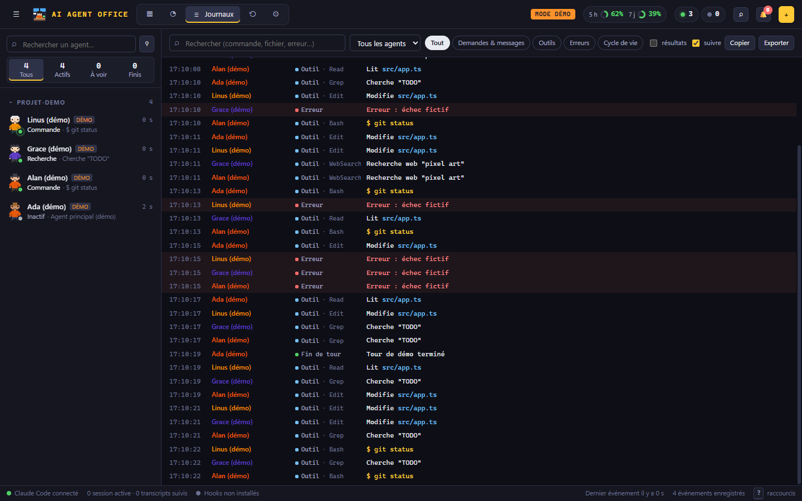

# AI Agent Office

[](https://github.com/N4ole/ai-agent-office/actions/workflows/ci.yml) [](https://github.com/N4ole/ai-agent-office/releases/latest) [](LICENSE)

[](https://github.com/N4ole/ai-agent-office/releases) [](docs/fr/README.md) [](docs/en/README.md) [](LICENSE)

Bureau virtuel en pixel art pour observer et piloter vos agents **Claude Code** en temps réel, sous Windows.
Chaque personnage est une vraie session ou un vrai sous-agent Claude Code ; chaque statut vient d’un événement réel
ou d’une déduction signalée comme telle.



<details>
<summary>Autres captures (tableau de bord, journaux)</summary>




</details>

*Captures du mode démo (agents fictifs), régénérées par `npm run screenshots`.*

## À savoir avant d’installer

- **Interface uniquement en français.** La documentation existe en français et en anglais, mais l’application
  elle-même (menus, messages, dates) n’est pas traduite. *The app UI is French only.*
- **Windows 10/11 uniquement.**
- **Claude Code est requis** : l’app observe les sessions de la CLI Claude Code, elle ne remplace pas Claude Code et
  n’appelle aucun modèle elle-même. Aucun appel réseau n’est fait par l’app.
- **Version testée** : formats de fichiers vérifiés sur Claude Code **2.1.312** (texte de `/usage` : 2.1.314).
  Les versions 2.1.x suivantes devraient fonctionner ; un format inconnu est ignoré sans planter.
- **Mode d’installation de Claude Code** : l’installeur natif (`claude.exe`) est le mode testé. L’installation
  via npm (`claude.cmd`) est prise en charge depuis la version qui suit la 1.3.1, **sans avoir encore été vérifiée sur
  une vraie installation npm** : signalez tout problème.
- **Sondage des quotas** : pour afficher les quotas d’abonnement, l’app lance en arrière-plan un processus `claude`
  (commande `/usage`, sans session enregistrée) **toutes les 5 minutes** par défaut. Réglable, ou désactivable (0)
  dans Paramètres → Notifications & seuils.
- Exécutables **non signés** : voir [vérifier un téléchargement](docs/fr/installation.md#vérifier-un-téléchargement).

## Documentation

| | Français | English |
|---|---|---|
| Sommaire / Contents | [docs/fr](docs/fr/README.md) | [docs/en](docs/en/README.md) |
| Installation | [Installation](docs/fr/installation.md) | [Installation](docs/en/installation.md) |
| Utilisation / Usage | [Utilisation](docs/fr/utilisation.md) | [Usage](docs/en/usage.md) |
| Fonctionnement / How it works | [Fonctionnement](docs/fr/fonctionnement.md) | [How it works](docs/en/how-it-works.md) |
| Développement / Development | [Développement](docs/fr/developpement.md) | [Development](docs/en/development.md) |
| Grille tarifaire / Price table | [Tarifs](docs/fr/tarifs.md) | [Pricing](docs/en/pricing.md) |
| Historique / Changelog | [CHANGELOG.md](CHANGELOG.md) | [CHANGELOG.md](CHANGELOG.md) |
| Contribuer / Contributing | [CONTRIBUTING.md](CONTRIBUTING.md) · [Sécurité](SECURITY.md) | [CONTRIBUTING.md](CONTRIBUTING.md) · [Security](SECURITY.md) |

## Lancer l’application

Les exécutables ne sont pas versionnés dans le dépôt : récupérez-les dans l’onglet **Releases** de GitHub, ou
construisez-les vous-même (`npm run dist`, voir *Développement*). Ils sont produits dans `release\`.

- **Fichier unique (portable)** : `AI-Agent-Office-<version>-portable.exe`, double-clic, sans installation.
  Il se décompresse à chaque lancement (quelques secondes).
- **Installateur** : `AI-Agent-Office-Setup-<version>.exe` (raccourci bureau, désinstallation propre).
- Les exécutables ne sont pas signés : SmartScreen → « Informations complémentaires » → « Exécuter quand même ».
- Prérequis : Claude Code CLI (`claude --version`). Node.js uniquement pour les hooks optionnels.
- L’historique est conservé dans `%APPDATA%\AI Agent Office` (commun aux deux versions).

## Nouveautés de la 1.3

- **Quotas restants (abonnement Claude)** : widget dans la barre du haut (fenêtre de 5 h et semaine, % restant,
  heure de réinitialisation) et carte dans le tableau de bord. Source : la commande `/usage` de Claude Code, exécutée
  en arrière-plan toutes les 5 min (réglable dans Paramètres → Notifications & seuils, 0 = manuel). Elle est traitée
  localement par Claude Code : aucun token, 0 $, rien n’est enregistré, et elle n’apparaît jamais comme un agent.
  Les sessions lancées depuis l’app mettent aussi le quota à jour en direct (`rate_limit_event`).
  Alerte à 80 % puis 95 % d’utilisation. Rien n’est affiché si Claude Code est utilisé avec une clé API.
- Le graphique « Tokens générés par jour » reprend sa présentation d’origine.

## Nouveautés de la 1.2

- **Coût estimé par chat** : tokens de chaque réponse × tarif API public du modèle qui l’a produite (entrée, sortie,
  cache lu, cache écrit 5 min / 1 h, palier Haiku 5.5 au-delà de 100K). Détail par modèle dans la fiche agent,
  total « chat » = agent + ses sous-agents, coût par chat et par modèle dans le tableau de bord, colonne dans l’historique,
  grille de tarifs et source dans Paramètres → Tarifs. Vérifié sur des sessions réelles : identique au centime au relevé
  de Claude Code quand celui-ci est à jour. Le relevé de Claude Code reste affiché à côté ; il peut dater d’avant les
  derniers échanges.
- **Compatibilité écran** : la fenêtre s’adapte à l’écran (ordinateurs portables à 125–150 %), mémorise sa taille,
  interface compacte en dessous de 1440 / 1280 / 1100 px, liste des agents masquable (☰ ou Ctrl+B), fiche agent en
  surimpression sur les fenêtres étroites, caméra qui garde le bureau cadré. Testé de 900×600 à 2560×1440, à 100, 125,
  150 et 200 % de mise à l’échelle.

## Nouveautés de la 1.1 (interface)

- **Barre latérale** : onglets rapides Tous / Actifs / À voir / Finis avec compteurs, filtres avancés repliables
  (projet, type, session, activité, priorité), avatars pixel, dernière action et ancienneté, groupes repliables,
  sous-agents en arborescence.
- **Bureau** : compteurs en surimpression, barre d’outils verticale, caméra fluide qui suit l’agent sélectionné,
  halo sous l’agent sélectionné, éclairage qui suit l’heure réelle (jour, crépuscule, nuit avec lampes de bureau),
  bulles d’action qui ne se chevauchent plus.
- **Fiche agent** : « ce qu’il fait maintenant » en tête, tuiles tokens / coût / actions / durée, sections repliables ;
  seules les actions réellement possibles sont proposées, les autres sont listées avec leur raison.
- **Tableau de bord** : indicateurs colorés, tokens sur 14 jours (jours vides inclus), coût par session, organigramme.
- **Journaux** : couleur par type d’événement, séparateurs par jour, résultats d’outils masquables.
- **Paramètres** en sections, interrupteurs, assistant de démarrage repensé.
- **Barre d’état** : connexion à Claude Code, sessions actives, sessions pilotées, hooks, dernier événement.
- **Recherche globale** (Ctrl+K) groupée par vues, agents et événements.

## Ce que l’app observe (sans rien modifier)

| Source (Claude Code) | Ce qu’on en tire |
|---|---|
| `~/.claude/sessions/<pid>.json` | sessions actives, PID, dossier, statut `busy` / `idle` |
| `~/.claude/projects/<dossier>/<session>.jsonl` | demandes, outils, fichiers lus/modifiés, commandes, résultats, erreurs, tokens, coût |
| `…/<session>/subagents/agent-<id>.jsonl` + `.meta.json` | sous-agents, leur type, leur parent, leur fin |
| Processus Windows (toutes les 10 s) | CPU et RAM des processus Claude Code |
| Hooks optionnels | « agent en attente d’autorisation », fin exacte de session |

Chaque valeur porte un badge **observé**, **déduit** ou **indispo.** ; rien n’est inventé.

## Ce que l’app peut piloter

| Action | Session lancée depuis l’app | Session lancée dans un terminal | Sous-agent |
|---|---|---|---|
| Envoyer une instruction, interrompre | ✔ | ✖ pas d’interface documentée | ✖ piloté par son parent |
| Pause | ✖ n’existe pas dans Claude Code (utilisez Interrompre) | ✖ | ✖ |
| Arrêter (avec confirmation) | ✔ | ✔ arrêt forcé | ✖ |
| Reprendre (`--resume`) dans l’app ou un terminal | ✔ une fois arrêtée | ✔ une fois fermée | — |
| Terminal intégré | ✔ sortie réelle du processus | ✖ (onglet Journal) | — |
| Ouvrir un terminal / le dossier | ✔ | ✔ | ✔ |

Raccourcis : `1…5` vues · `Ctrl+K` recherche · `Ctrl+N` nouvelle session · `J/K` agent suivant · `F` centrer ·
`+ − 0` zoom · `L` liens · `B` bulles · `Échap` fermer · `?` aide.

## Limites connues

- Pas d’instruction ni de pause pour les sessions interactives lancées hors de l’app (aucune API documentée).
- Le coût estimé est un équivalent au tarif API : avec un abonnement claude.ai, ce n’est pas le montant facturé.
  Les appels internes de Claude Code absents des transcripts (ex. génération de titres) ne sont pas comptés.
- Progression mesurable uniquement si l’agent tient une liste de tâches.
- « Bloqué » sans hooks est une déduction (aucun événement depuis N minutes, réglable).
- Format de fichiers vérifié sur Claude Code 2.1.x ; les enregistrements inconnus sont ignorés.
- Les quotas viennent du texte affiché par `/usage` : si une future version de Claude Code change ce texte, le widget
  affiche « Format de /usage non reconnu » (et garde les dernières valeurs) au lieu d’inventer un chiffre.
- Le coût estimé repose sur une grille tarifaire datée ([date, source et mise à jour](docs/fr/tarifs.md)).

## Dépannage

### Le quota affiche « Format de /usage non reconnu », « Réponse de /usage vide » ou une erreur `ENOENT`

- `ENOENT` / « introuvable » : Claude Code n’est pas trouvé. Vérifiez `claude --version` dans un terminal, ou
  indiquez le chemin complet de `claude.exe` (ou `claude.cmd` pour une installation npm) dans Paramètres → Connexion à Claude Code.
- « non reconnu » : votre version de Claude Code affiche `/usage` autrement que la 2.1.314. Les dernières valeurs
  connues restent affichées ; ouvrez une issue avec la sortie de `claude -p "/usage"` (en masquant ce qui est privé).
- Avec une **clé API** (et non un abonnement claude.ai), il n’y a pas de quota : rien n’est affiché, c’est normal.
- « Pas de réponse dans le délai » : Claude Code a mis plus de 30 s à répondre (premier lancement, mise à jour) ;
  cliquez sur Actualiser un peu plus tard.

### Les alertes « en attente d’autorisation » n’arrivent pas (hooks inactifs)

- Les hooks sont optionnels : Paramètres → Hooks optionnels → Installer les hooks. Ils ne s’appliquent qu’aux sessions
  Claude Code **démarrées après** l’installation.
- Ils nécessitent **Node.js** dans le `PATH` (la vérification « Node.js » de l’assistant doit être verte).
- Vérifiez que `~/.claude/settings.json` contient des entrées `ai-agent-office` (une sauvegarde horodatée
  `settings.json.ai-agent-office-<date>.bak` est faite à chaque modification).
- Si l’app signale un « mode dégradé », le dossier `%USERPROFILE%\.ai-agent-office` n’est pas accessible en
  écriture : corrigez ses droits puis relancez l’app.

### Node.js absent

- Tout fonctionne sans Node.js sauf les hooks optionnels. Pour les activer, installez Node.js LTS depuis
  [nodejs.org](https://nodejs.org), redémarrez l’app puis réinstallez les hooks.

### Antivirus ou SmartScreen bloque l’exécutable

- SmartScreen : « Informations complémentaires » → « Exécuter quand même » (exécutables non signés).
- Avant d’ajouter une exception, [vérifiez l’empreinte SHA-256 et la provenance](docs/fr/installation.md#vérifier-un-téléchargement)
  du fichier.
- La version **portable** se décompresse à chaque lancement et déclenche plus souvent les antivirus : préférez
  l’installateur, ou construisez l’app vous-même (`npm run dist`).

Autres cas : [Utilisation → Dépannage](docs/fr/utilisation.md).

## Développement

```bash
npm ci                 # si npm bloque les scripts : node node_modules/electron/install.js
npm run dev            # Vite + Electron
npm test               # tests (vitest)
npm run lint:setup && npm run lint
npm run screenshots    # régénère docs/images/*.png (mode démo, ouvre une fenêtre ~20 s)
npm run dist           # installateur + portable dans release/ (essai local ; les releases sont faites par la CI)
```

Voir [CONTRIBUTING.md](CONTRIBUTING.md).

`src/main/` : connecteur Claude Code, état des agents, base SQLite, notifications ·
`src/renderer/` : interface React et moteur pixel art (`office/`).
